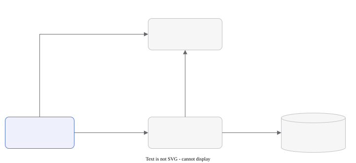

# Lesson hub and accounts

For how to use this, see [Lesson hub and accounts](../../guide/hub-and-accounts.md).

The lesson hub is backed by **Supabase Postgres**, but, like the AI and image
features, the browser never talks to the database directly. Every lesson,
comment and rating read or write goes through the API (`apps/api` in this
monorepo), which holds the privileged Supabase service-role key. The only thing
the browser does directly with Supabase is **authentication**.

The routes are registered in `apps/api/src/app.js`, which both the Cloudflare
Worker entry (`src/index.js`) and the Node entry (`src/node/server.js`) build
on. The hub handlers are `routes/lessons.js` and `routes/comments.js`, with
shared helpers in `lib/lesson.js` (row mapping, the trusted-collaborator check,
the read-permission rule), `lib/auth.js`, `lib/bans.js` and `lib/ratings.js`.
The frontend wrappers are `@spelling-creator/core/lessons` and
`@spelling-creator/core/comments`.

## Sign-in

The login page (`/login`, `LoginPage.jsx`) and the session context
(`apps/web/src/lib/auth.jsx`) use [Supabase Auth](https://supabase.com/docs/guides/auth).
The Supabase JS client comes from `@spelling-creator/core/browser/supabase` and
is configured with the **PKCE** flow, so a magic-link callback returns a
`?code=` in the query string rather than access tokens in the URL fragment.

How people sign in is set per instance by the `authMode` config
(`VITE_AUTH_MODE` at build time, `AUTH_MODE` in the self-hosted
`docker-compose.yml`): `magic-link` (the default and what the hosted instance
uses), `password` (username or email plus password, no mail server needed) or
`both`. See [Self-hosting](../self-hosting.md) for the password mode.

### The email code

A magic-link email also carries a one-time **code**. The "Check your email"
screen, on `/login` and on the MCP consent screen
(`OAuthAuthorizePage.jsx`, see [Remote mode](../mcp-server/remote-mode.md)), has
a field for it from the shared `EmailCodeForm` component. Typing the code calls
`verifyOtp`, which signs in right where it's typed with no redirect. That is
what makes sign-in work in the installed app (see
[PWA and offline](./pwa-and-offline.md)), where the link usually opens in a
different browser. The MCP server's `login` helper (`apps/mcp/src/login.js`)
uses the same code.

**On hosted Supabase, the email templates need the code added**, since
Supabase's default templates leave it out. Go to
**Authentication > Email Templates** and add this line to **both** of these
templates:

- **Magic Link**, which a returning user gets.
- **Confirm signup**, which a first-time address gets instead, because
  `signInWithOtp` creates the account and sends that email the first time.

```html
<p>Or enter this code in the app: <strong>{{ .Token }}</strong></p>
```

Until both have it, the code field has nothing to accept and the installed app
can't sign in. The link keeps working either way. The
[self-hosted stack](../self-hosting.md) needs nothing: the GoTrue version it
pins already puts the code in both emails.

### How the API checks a session

The app sends the session JWT to the API as a `Bearer` token. The API verifies
it with `verifySupabaseUser` (`lib/supabase.js`), which calls
`GET {SUPABASE_URL}/auth/v1/user` with the token rather than checking a
signature locally. That needs no JWT secret and keeps working if the project
moves to asymmetric signing keys. The author of anything written is always
taken from the verified user, never from the request body.



What the API checks before it touches Postgres, route by route:

| Route                              | Needs a JWT                              | Checks                                           |
| ---------------------------------- | ---------------------------------------- | ------------------------------------------------ |
| `GET /lessons`, `GET /lessons/:id` | Only for drafts and shadowbanned lessons | None, beyond who may read the lesson             |
| `GET /lessons/mine`                | Yes                                      | Returns your own lessons and drafts              |
| `POST /lessons`                    | Yes                                      | Ban check, then publishes or saves a draft       |
| `PUT /lessons/:id`                 | Yes                                      | The author or a trusted collaborator             |
| `DELETE /lessons/:id`              | Yes                                      | The author only                                  |
| `GET /lessons/:id/comments`        | The same visibility rule as the lesson   | None, beyond who may read the lesson             |
| `POST /lessons/:id/comments`       | Yes                                      | Ban check, sanitizing and the profanity check    |
| `PATCH /lessons/:id/comments/:cid` | Yes                                      | The author only, plus the same checks as posting |

## Comments

Comments are written with a [tiptap](https://tiptap.dev) editor
(`RichTextInput.jsx`) and stored as sanitized HTML. The API's sanitizer
(`lib/richtext.js`) is the only authority on what survives, so media can't be
embedded even with a hand-crafted request. See [Rich text](./rich-text.md).

Profanity is checked on the API with
[`glin-profanity`](https://www.npmjs.com/package/glin-profanity)
(`lib/profanity.js`). A comment that fails is rejected outright with `422`;
nothing is stored or censored-and-kept.

Editing runs the same sanitize, length and profanity checks as posting, so an
edit can't launder content past the rules. Moderators can delete a comment but
not rewrite one; see [Moderation](./moderation.md).

Comment translation happens entirely in the browser; see
[Comment translation](./comment-translation.md).

## Forking and trusted collaborators

A fork is a **clone of the lesson's git repository**: it carries the original's
full version history and shares its ancestry. The new lesson records its origin
in `lessons.forked_from` (sent as `forkedFrom` on `POST /lessons`), which lets it
later pull the original's changes in with a three-way merge. See
[Version history](../version-history.md). Work goes back from a fork as a
proposal; see [Pull requests](./pull-requests.md).

Trusted collaborators live on the lesson's own document
(`doc.trustedCollaborators`, entries `{ email, name? }`), checked by
`isTrustedCollaborator` in `lib/lesson.js`. They are the one kind of non-author
who may write a lesson directly: its title, document and history, but never its
published state, the trusted list itself, or its existence (no delete). History
pushes (`PUT /git/:id/pack`, `routes/git.js`) are compare-and-swapped on the
history's head, so neither the author nor a collaborator can overwrite work they
haven't seen; whoever is stale gets a `409` and must merge and retry. A
collaborator's `PUT /lessons/:id` notifies the author with a `lesson_update`
[notification](./notifications.md).

## API endpoints (contract)

The frontend expects these under the configured API base URL (`VITE_API_URL`).
The API also has the profile, notification and moderation endpoints documented
on their own pages.

A **LessonSummary** is
`{ id, authorId, title, author, sectionCount, published, shadowbanned, forkedFrom, forkedFromUrl, createdAt }`.
`forkedFrom` is the hub lesson this one was forked from, and `forkedFromUrl`
the page it was forked from on another instance (see
[Federation](../federation.md#forking-a-lesson-from-another-instance)); a
lesson has at most one of the two.

| Method and path                               | Auth                    | Response                                                                                                           |
| --------------------------------------------- | ----------------------- | ------------------------------------------------------------------------------------------------------------------ |
| `GET /lessons`                                | none                    | `{ lessons: LessonSummary[] }`, published and not shadowbanned, newest first                                       |
| `GET /lessons/mine`                           | `Bearer <Supabase JWT>` | `{ lessons: LessonSummary[] }`, the caller's own, drafts included                                                  |
| `GET /lessons/:id`                            | none, unless private\*  | `{ lesson: { ...LessonSummary, doc, avgRating, ratingCount } }`                                                    |
| `POST /lessons`                               | `Bearer <Supabase JWT>` | `201 { lesson: LessonSummary }`                                                                                    |
| `PUT /lessons/:id`                            | `Bearer <Supabase JWT>` | `{ lesson: LessonSummary }`; the author, or a trusted collaborator (title and doc only); anyone else `403`         |
| `DELETE /lessons/:id`                         | `Bearer <Supabase JWT>` | `{ ok: true }`; the author only, anyone else `403`                                                                 |
| `GET /lessons/:id/comments`                   | none, unless private\*  | `{ comments: [{ id, parentId, authorId, author, body, createdAt, editedAt }] }`, oldest first                      |
| `POST /lessons/:id/comments`                  | `Bearer <Supabase JWT>` | `201 { comment, rating: { average, count } \| null }`                                                              |
| `PATCH /lessons/:id/comments/:commentId`      | `Bearer <Supabase JWT>` | `{ comment }`; the comment's author only, else `403`                                                               |
| `GET /lessons/:id/pulls`                      | none, unless private\*  | `{ pulls: [...], canReview }`; see [Pull requests](./pull-requests.md)                                             |
| `POST /lessons/:id/pulls`                     | `Bearer <Supabase JWT>` | `{ pull }`, opening a proposal                                                                                     |
| `/lessons/:id/pulls/:prId/{pack,merge,close}` | `Bearer`, except `GET`  | A proposal's packfile, and resolving it; see [Pull requests](./pull-requests.md)                                   |
| `GET/POST /lessons/:id/responses`             | `Bearer <Supabase JWT>` | Your own saved answers from interactive mode, private to the caller; see [Interactive mode](./interactive-mode.md) |
| `DELETE /lessons/:id/responses/:rid`          | `Bearer <Supabase JWT>` | `{ ok: true }`; deletes one of your own saved run-throughs; anyone else's matches nothing and `404`s               |
| `POST /ai-text/dislike`                       | `Bearer <Supabase JWT>` | `{ ok: true }`; evicts the cached text for `{ subject, documentName }`                                             |
| `GET /remote`                                 | none                    | `{ available }`: whether this instance can copy lessons from others (it federates)                                 |
| `GET /remote/lesson?url=`                     | `Bearer <Supabase JWT>` | `{ lesson }` for a lesson page on another federating instance; see [Federation](../federation.md)                  |
| `GET /remote/pack?url=`                       | `Bearer <Supabase JWT>` | That lesson's packed history, as `GET /git/:id/pack` serves one                                                    |

\* A published, non-shadowbanned lesson needs no auth. A **draft**
(`published: false`) or a **shadowbanned** lesson is private: having the id or
URL is not enough, so `GET /lessons/:id`, its comments, its pulls and its stored
history all `404` unless the request carries a `Bearer` token for the lesson's
author, a trusted collaborator, or a moderator or admin. This one rule lives in
`canReadLesson` (`lib/lesson.js`). The frontend (`fetchLesson`, `fetchComments`)
always sends the signed-in user's token when there is one, so authors see their
own drafts without doing anything special.

Notes:

- **The trusted list is stripped from reads.** `doc.trustedCollaborators` holds
  email addresses, and `GET /lessons/:id` is public (and server-rendered into the
  page), so `rowToLesson` strips the field for everyone except the lesson's
  author and the collaborators on the list; not the public, and not moderators.
  A published lesson is still read without verifying anything; a token is only
  checked when one was actually sent. Since a document can therefore arrive back
  without the field, `PUT` treats an absent list as "leave the stored one
  alone"; only an explicit array (the collaboration dialog sends `[]` to clear
  it) replaces it. A trusted collaborator's `PUT` always keeps the stored list,
  whatever they send. See [Version history](../version-history.md).
- **Moderator fields.** A moderator or admin reading a draft or shadowbanned
  lesson also gets `authorIp`. The published-lesson path doesn't attach it, so
  the lesson page's "ban by IP" action only has an address for a lesson that is
  a draft or shadowbanned.
- `doc` is the editor document shape used throughout the app:
  `{ title, sections: [{ id, name, blocks: [...] }] }`, stored as `jsonb`.
- **`POST /lessons`** body is
  `{ title, doc, published?, forkedFrom?, forkedFromUrl? }`. The caller must
  not be banned (`403 "Your access has been suspended."`) and must have a
  display name (`403` otherwise). `doc.sections` must be a non-empty array
  (`400`). The title falls back to `doc.title`, then "Untitled Lesson", and is
  cut to 300 characters. `published` defaults to `true` when omitted, so an
  older client still publishes. An invalid `forkedFrom` or `forkedFromUrl`
  (anything but an http(s) address) is dropped rather than failing the save,
  and `forkedFromUrl` is ignored when `forkedFrom` is given. The author's IP
  is recorded in `author_ip` for moderation.
- **Draft cap.** A user may hold at most `MAX_DRAFTS` (8) private drafts. A save
  that would create a ninth, by `POST` or by a `PUT` that turns a published
  lesson into a draft, is rejected with `409`. Re-saving an existing draft never
  counts against it, and published lessons are unlimited.
- **`PUT /lessons/:id`** body is `{ title, doc, published? }`. The API loads the
  existing row (with its doc, since the trusted list lives there) to decide who
  is writing: the author may change everything, including `published`; a trusted
  collaborator may change only `title` and `doc`; anyone else gets `403`. Banned
  callers are rejected. `author` and `created_at` are never changed.
- **`DELETE /lessons/:id`** is author-only. It confirms ownership by filtering on
  `id` and `author_id`, sweeps the packs of any proposals against the lesson,
  deletes the lesson's comments first (so it works even on an older database
  whose comment foreign key doesn't cascade), deletes the row, and then drops
  the lesson's stored history.
- **`POST /lessons/:id/comments`** body is `{ body, parentId?, rating? }`, where
  `body` is rich-text HTML. The API checks bans and the display name, then
  sanitizes the HTML and judges the _resulting text_: empty after sanitizing is
  `400`, over `MAX_COMMENT_LENGTH` (2000) characters of text is `400`, and any
  profanity is `422`. Raw markup over 20000 characters is refused before
  parsing. A `parentId` must belong to the same lesson (`404` otherwise). An
  optional `rating` (whole number 1 to 5, else `400`) is upserted into `ratings`
  keyed by `(lesson_id, author_id)`, and the lesson's new `{ average, count }`
  comes back as `rating` (or `null` when no rating was sent or the write
  failed).
- **Reply notifications.** Only a reply (a comment with `parentId`) notifies
  anyone: the parent comment's author ("replied to your comment") and the
  lesson's author ("replied to a comment on your lesson"), deduplicated when
  they're the same person and never notifying the replier. A new top-level
  comment notifies nobody. The notification body is the comment flattened to
  plain text.
- **`PATCH /lessons/:id/comments/:commentId`** body is `{ body }`. Ownership is
  decided by comparing the stored `author_id` against the verified JWT (a
  non-author gets `403`, a missing comment `404`). Banned callers are rejected.
  The new body runs through the same pipeline as a fresh post, and a successful
  edit stamps `edited_at`. Only the body changes; any rating stays as it was.
- **`POST /ai-text/dislike`** body is `{ subject, documentName }`. The API
  verifies the JWT, rebuilds the cache key for that text suggestion and deletes
  it, so the next request for the same subject is regenerated.
- On 4xx and 5xx the API returns a short **plain-text** reason, which the
  frontend shows directly.

## Supabase schema

There is no separate migrations folder. The canonical, ready-to-run schema is
[`apps/api/schema.sql`](https://github.com/Spelling-Creator/spelling-creator/blob/main/apps/api/schema.sql),
and it doubles as the migration script: every table is
`create table if not exists` and every later column is
`alter table ... add column if not exists`, so it is safe to re-run against an
existing database. Run it in the Supabase SQL editor (or with `psql`). The
self-hosted `docker-compose.yml` applies it automatically on first start.

Besides `lessons`, `comments` and `ratings` below, the file defines
`lesson_responses` (see [Interactive mode](./interactive-mode.md)),
`notifications` and `follows` (see [Notifications](./notifications.md) and
[Profiles](./profiles.md)), `lesson_pull_requests` (see
[Pull requests](./pull-requests.md)), the moderation tables `user_roles`,
`banned_names`, `banned_ips` and `lesson_delete_requests` (see
[Moderation](./moderation.md)), `kv_store`, the expiring key-value table a
self-hosted instance uses in place of Cloudflare KV (see
[Platform seam](../platform-seam.md)), and `federation_keys` and
`federation_followers` (see [Federation](../federation.md)).

**Row level security.** The API connects with the service-role key, which
bypasses RLS, so it is the only writer. RLS is enabled on every table anyway as
defense in depth. `lessons`, `comments` and `ratings` have a public `select`
policy; every other table has RLS on and no policies at all, so nothing but the
service role can read it. No table has an insert, update or delete policy for
the `anon` or `authenticated` roles.

The three hub tables, as they end up after all the `alter`s:

```sql
create table public.lessons (
  id            uuid primary key default gen_random_uuid(),
  author_id     uuid not null references auth.users (id) on delete cascade,
  author        text,                       -- display name, denormalized for listing
  title         text not null,
  doc           jsonb not null,             -- the editor document { title, sections }
  -- Maintained by Postgres so the listing can show a section count without
  -- downloading every (possibly image-laden) doc.
  section_count int generated always as (jsonb_array_length(doc -> 'sections')) stored,
  -- false = a private draft, kept out of the public listing. Defaults true so
  -- rows from before drafts existed stay visible.
  published     boolean not null default true,
  -- The lesson this one was forked from, or null for an original. Deleting the
  -- original orphans its forks rather than deleting them.
  forked_from   uuid references public.lessons (id) on delete set null,
  created_at    timestamptz not null default now(),
  -- Moderation (see the Moderation page).
  shadowbanned  boolean not null default false,
  author_ip     text                        -- only ever returned to mods/admins
);
create index lessons_forked_from_idx on public.lessons (forked_from);
create index lessons_created_at_idx on public.lessons (created_at desc);

create table public.comments (
  id          uuid primary key default gen_random_uuid(),
  lesson_id   uuid not null references public.lessons (id) on delete cascade,
  -- The comment this one replies to, or null for a top-level comment. Deleting
  -- a comment deletes its replies.
  parent_id   uuid references public.comments (id) on delete cascade,
  author_id   uuid not null references auth.users (id) on delete cascade,
  author      text,
  body        text not null,                -- sanitized rich-text HTML (older rows are plain text)
  created_at  timestamptz not null default now(),
  author_ip   text,
  edited_at   timestamptz                   -- null until the author edits it
);
create index comments_lesson_id_idx on public.comments (lesson_id, created_at);
create index comments_parent_id_idx on public.comments (parent_id);

create table public.ratings (
  lesson_id  uuid not null references public.lessons (id) on delete cascade,
  author_id  uuid not null references auth.users (id) on delete cascade,
  stars      smallint not null check (stars between 1 and 5),
  created_at timestamptz not null default now(),
  primary key (lesson_id, author_id)        -- one rating per user per lesson
);
create index ratings_lesson_id_idx on public.ratings (lesson_id);
```
