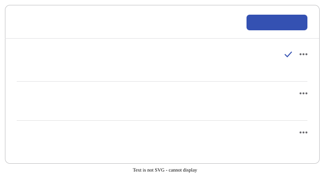

# Lessons on this device

The editor keeps **every lesson you work on**, as many as you make. They're
stored in your browser, and they're listed on the **Lessons on this device**
page. You can get there from:

- **On this device** in the app header,
- the **Lessons** button at the top of the editor, or
- **Manage lessons** in Settings, under **This device**.

Nothing you're working on is ever replaced. Opening a lesson from the hub,
forking one, or importing a file always adds a new lesson to the list instead
of overwriting the one on screen.

## The page

Click a lesson to open it in the editor. The tick marks the lesson the editor
had open last, which is the one it goes back to. The label on the right (shown
on wider screens) says where else the lesson exists: **Published** on the hub,
or a private **Cloud draft**. A lesson with no label is only on this device.

The menu on each lesson (the three dots) has three actions:

| Action                      | What it does                                                                                       |
| --------------------------- | -------------------------------------------------------------------------------------------------- |
| **Rename**                  | Changes its title. This is the same as editing the title at the top of the editor.                 |
| **Duplicate**               | Makes a full copy, including its version history, called "... (copy)". The copy isn't on the hub.  |
| **Delete from this device** | Removes the lesson and its history from this browser. It asks you to confirm, and can't be undone. |

**New lesson** starts an empty lesson and opens it. If the lesson you're
already in is still untouched, you stay in it instead of getting a second empty
one. If you delete the lesson the editor last had open, the editor opens the
most recent one left next time, or starts a fresh one if there are none.

## What each action does

| You do this                                | What happens                                                                                                                                                                  |
| ------------------------------------------ | ----------------------------------------------------------------------------------------------------------------------------------------------------------------------------- |
| **New lesson** (app header)                | Adds an empty lesson and opens it. Pressing it while you're in an untouched one keeps you there.                                                                              |
| **Edit** on one of your hub lessons        | Opens the copy this device already has, exactly as you left it. You never get a second copy, and the cloud's version never overwrites yours. If the two differ, it tells you. |
| **Fork** a lesson from the hub             | Adds a new lesson with the original's history, called "... (copy)".                                                                                                           |
| **Fork into a new lesson** (in the editor) | The same, from the lesson you're in. That lesson stays in the list, still connected to the hub.                                                                               |
| **Import** a Word or JSON file, or text    | Adds a new lesson whose history starts at the import. [Import from text](./import-from-text.md) reads documents that weren't made by this app.                                |
| **Save to cloud** on a lesson only here    | Connects it to the new hub lesson it creates (published or as a draft), and takes its history with it.                                                                        |
| **Join** someone's live session            | Once the host lets you in, adds a new lesson holding the session's lesson (or uses the untouched one you're in). It stays in the list after the session ends.                 |

## What this doesn't do

These lessons are **only in this browser**. Nothing here syncs: another
browser, another device or another browser profile has its own list, and
clearing your browsing data deletes them. Saving a lesson to the cloud,
published or as a private draft, is the only thing that keeps a copy somewhere
else. The page says so at the bottom too.

Deleting a lesson that's been saved to the cloud only removes the copy on this
device. The hub keeps the lesson and its history, and opening it for editing
again brings that history back down.

Because the copy here is never replaced, it can get out of step with the cloud
copy: edits made here and not saved yet, or edits saved from another device.
Saving to the cloud sorts that out. If the lesson has changed in the cloud
since you last synced, the save stops and offers to merge the changes block by
block, so nothing is overwritten.

For how this works, see the [developer notes](../developers/web-app/local-lessons.md).
